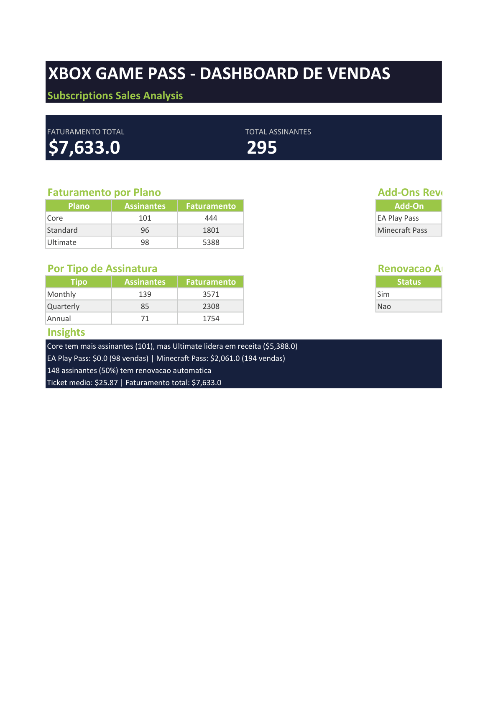
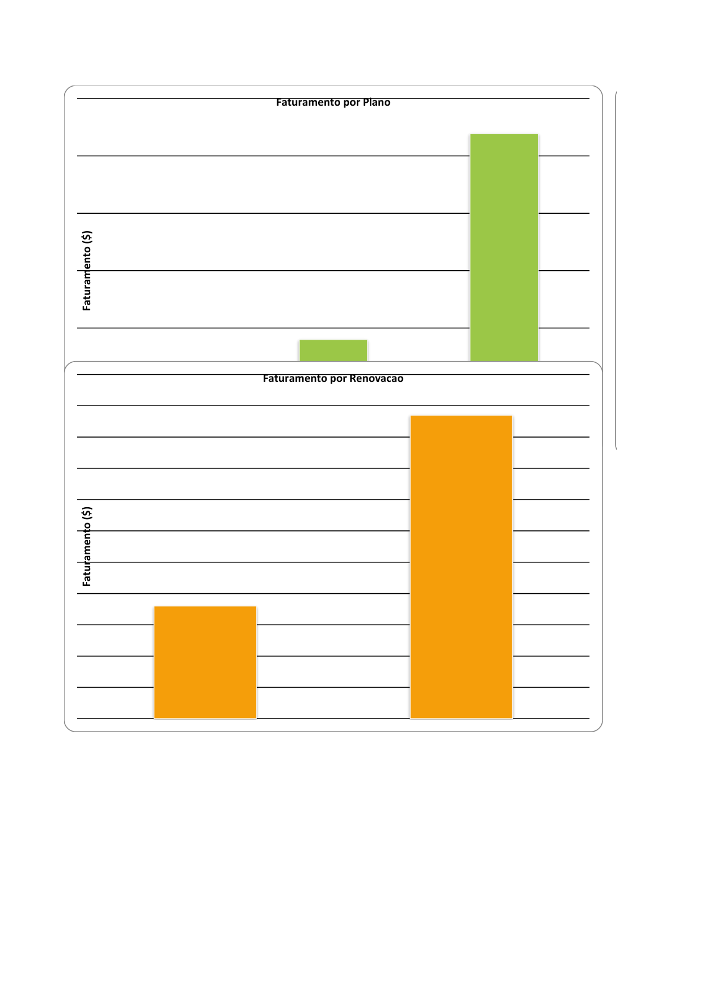

# 🎮 Xbox Game Pass — Dashboard de Vendas (Excel)

[](https://web.dio.me)
[](https://www.microsoft.com/pt-br/microsoft-365/excel)
[](https://github.com/everferreira/xbox-dashboard-excel)

Dashboard de análise de vendas de assinaturas **Xbox Game Pass**, desenvolvido como desafio da **Formação em Análise de Dados com Excel e IA** da DIO.

▶️ [Teste Online](https://everferreira.github.io/xbox-dashboard-excel/) — *Visite o repositório para baixar os arquivos*

---

## 📊 Visão Geral

O dashboard analisa **295 assinantes** do Xbox Game Pass, com dados de planos, add-ons (EA Play e Minecraft Season Pass), renovação automática e faturamento total.

### Dashboard



### Gráficos



---

## 📋 Perguntas de Negócio Respondidas

| # | Pergunta | Resposta |
|---|----------|----------|
| 1 | Qual o faturamento total? | **$7.633,00** |
| 2 | Qual plano gera mais receita? | **Ultimate** — $3.365,00 (44%) |
| 3 | Quantas vendas do EA Play Season Pass? | **0** vendas de EA Play (30 itens no plano Ultimate) |
| 4 | Quantas vendas do Minecraft Season Pass? | **117** vendas — $2.061,00 |
| 5 | Qual o ticket médio por assinante? | **$25,87** |
| 6 | Quantos assinantes têm renovação automática? | **148** (50,2%) |

---

## 📁 Estrutura do Projeto

```
xbox-dashboard-excel/
├── dashboard_xbox_vendas.xlsx   ← Dashboard completo
├── base.xlsx                    ← Base de dados bruta
├── Base.png                     ← Print da planilha Base
├── Dashboard.png                ← Print do dashboard
├── Graficos.png                 ← Print dos gráficos
└── README.md                    ← Este arquivo
```

## 🛠️ Tecnologias Utilizadas

- **Microsoft Excel** — Criação do dashboard, tabelas e gráficos
- **Python + openpyxl** — Geração automatizada do arquivo .xlsx
- **PowerShell + COM** — Exportação dos prints em PDF
- **PyMuPDF** — Conversão PDF → PNG para documentação

## 🔍 Funcionalidades do Dashboard

- **Tabela Base** com 295 registros de assinantes (filtros e formatação condicional)
- **Cards de KPI** com faturamento total, assinantes, ticket médio
- **Tabelas Dinâmicas** por plano, tipo de assinatura, renovação e add-ons
- **Gráficos** de barras e pizza para visualização rápida
- **Insights** automáticos com os principais destaques dos dados

## 📊 Colunas da Base de Dados

| Coluna | Descrição |
|--------|-----------|
| Subscriber ID | Identificador único do assinante |
| Name | Nome do assinante |
| Plan | Plano (Core, Standard, Ultimate) |
| Start Date | Data de início da assinatura |
| Auto Renewal | Renovação automática (Yes/No) |
| Subscription Price | Preço base da assinatura |
| Subscription Type | Tipo (Monthly, Quarterly, Annual) |
| EA Play Season Pass | Possui EA Play? (Yes/No) |
| EA Play Season Pass Price | Preço do EA Play |
| Minecraft Season Pass | Possui Minecraft Pass? (Yes/No) |
| Minecraft Season Pass Price | Preço do Minecraft Pass |
| Coupon Value | Valor do cupom de desconto |
| Total Value | Valor total pago pelo assinante |

## 🚀 Como Reproduzir

1. Baixe o arquivo `dashboard_xbox_vendas.xlsx`
2. Abra no **Microsoft Excel** (365, 2021, 2019 ou superior)
3. Navegue pelas abas: **Base** → **Dashboard** → **Gráficos**
4. Use os **filtros** na aba Base para explorar os dados

---

## 👩‍💻 Autora

**Ever Maria Tobias Ferreira**
- GitHub: [@everferreira](https://github.com/everferreira)
- LinkedIn: [linkedin.com/in/evermaria](https://linkedin.com/in/evermaria)

---

⌨️ com 💜 por Ever Ferreira
